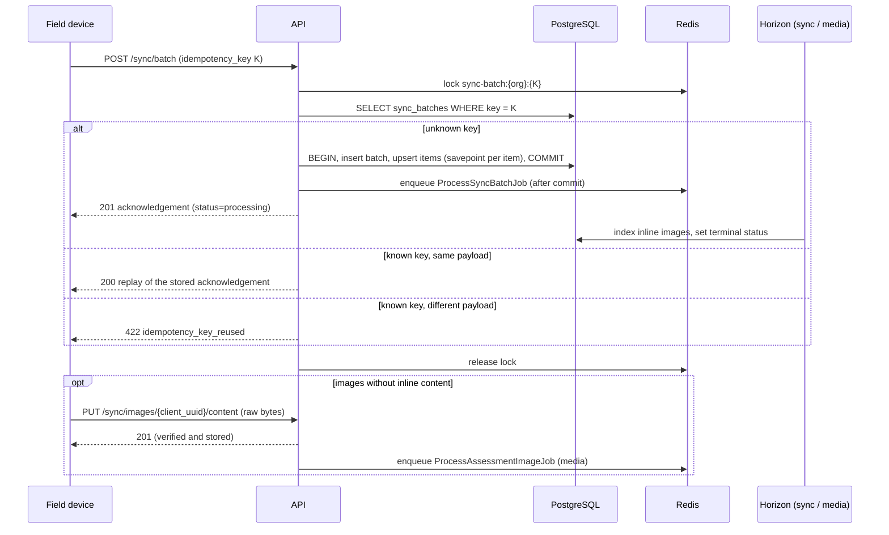

# API Reference: v1

Base URL: `https://<host>/api/v1`. Every response is JSON, including errors, whatever `Accept` header the client sends.

| Group | Endpoints |
|---|---|
| [Authentication](#2-authentication) | `POST /auth/login`, `GET /auth/me`, `POST /auth/refresh`, `POST /auth/logout`, `POST /auth/logout-all`, `GET /auth/tokens`, `DELETE /auth/tokens/{id}` |
| [Administration](#3-administration) | `DELETE /users/{user}/tokens` |
| [Offline sync](#4-offline-sync) | `POST /sync/batch`, `GET /sync/batches/{batch}`, `PUT /sync/images/{client_uuid}/content` |

An importable Postman collection is at [`postman-collection.json`](postman-collection.json).

---

## 1. Conventions

### 1.1 Headers

| Header | Direction | Notes |
|---|---|---|
| `Authorization: Bearer <id>\|rbai_<secret>` | request | Required on every endpoint except `POST /auth/login` |
| `Content-Type: application/json` | request | All bodies except `PUT /sync/images/{client_uuid}/content`, which takes raw image bytes |
| `Accept: application/json` | request | Optional (enforced server-side) |
| `Idempotent-Replayed: true\|false` | response | On `POST /sync/batch`: whether the response replays an earlier ingestion |
| `Retry-After: <seconds>` | response | On `409 sync_in_progress` and `429` |
| `Cache-Control: no-store` | response | On every response that carries a token secret |
| `X-RateLimit-Limit`, `X-RateLimit-Remaining` | response | Rate-limited routes |

### 1.2 Identifiers and formats

| Value | Format |
|---|---|
| Server ids (`id`, `batch_id`) | UUIDv7 string |
| `client_uuid`, `idempotency_key` | UUID generated on the device (v4 recommended) |
| Timestamps | ISO-8601 with offset, e.g. `2026-10-12T10:15:00+03:00`. Stored and returned in UTC |
| Dates | `YYYY-MM-DD` |
| Coordinates | WGS84 decimal degrees: `{"lat": 31.5017, "lng": 34.4668}` |
| Hashes | SHA-256, 64 hex characters (case-insensitive on input, lowercase on output) |

JSON object key order is not guaranteed. Clients must not depend on it.

### 1.3 Status codes

| Code | Meaning |
|---|---|
| `200` | Success (also: replay of an already ingested batch, or idempotent image re-upload) |
| `201` | Resource created (token issued, batch ingested, image binary stored) |
| `204` | Success without body |
| `401` | Missing, invalid, expired or revoked token; user or organization disabled |
| `403` | Authenticated but not allowed: missing ability, wrong device, or role not allowed on this client type |
| `404` | Not found **or belongs to another organization** (the API never confirms that other tenants' records exist) |
| `409` | `sync_in_progress`: the same batch is being ingested right now |
| `413` | Image body larger than the configured limit |
| `422` | Validation error, or a semantic rejection with a `code` |
| `429` | Rate limit exceeded |
| `500` | Unexpected server error (e.g. database unreachable). Nothing was committed; safe to retry |
| `503` | Image storage temporarily unavailable. Safe to retry |

### 1.4 Error bodies

Validation errors (`422`):

```json
{
  "message": "The assessments.0.location.lat field must be between -90 and 90.",
  "errors": {
    "assessments.0.location.lat": ["The assessments.0.location.lat field must be between -90 and 90."]
  }
}
```

Semantic errors carry a machine-readable `code`:

```json
{ "message": "…", "code": "idempotency_key_reused", "batch_id": "0199…" }
```

`401`: `{"message": "Unauthenticated."}`. `403`: `{"message": "Invalid ability provided."}` or `{"message": "This action is unauthorized."}`.

### 1.5 Rate limits

| Scope | Limit |
|---|---|
| `POST /auth/login` | 5/min per (email, IP) and 60/min per IP |
| All authenticated routes | 240/min per user (`API_RATE_LIMIT_PER_MINUTE`) |

---

## 2. Authentication

Token lifecycle, client types and the permissions matrix are specified in [authentication-rbac.md](../security/authentication-rbac.md). Summary of the endpoints:

### `POST /auth/login`

| Field | Type | Rules |
|---|---|---|
| `email` | string | required, email |
| `password` | string | required |
| `client_type` | string | required: `field_device` \| `web_dashboard` |
| `device_name` | string | required, ≤ 255 |
| `device_id` | string | required for `field_device`; 8–128 chars, `[A-Za-z0-9._:-]` |

`201` → `data.{token_type, access_token, expires_at, client_type, abilities[], user}`. Errors: `422` (validation / bad credentials, both under `errors.email`), `403` (account or organization disabled, role not allowed on this client type), `429`.

### `GET /auth/me`

Requires `profile:read`. `200` → `data.user` (with `organization`) and `data.token` (metadata of the presented token, never the secret).

### `POST /auth/refresh`

Rotates the presented token: the old one is revoked and the new secret is returned once. Same response shape as login, with status `200`. `403` if the account may no longer use this client type.

### `POST /auth/logout` · `POST /auth/logout-all`

`204`. Revokes the presented token, or every token of the user.

### `GET /auth/tokens`

`200` → `data[]` of `{id, name, client_type, device_id, abilities[], last_used_at, expires_at, created_at, is_current}` for the caller's unexpired tokens.

### `DELETE /auth/tokens/{id}`

`204`. Revokes one of the caller's own tokens. Another user's token id returns `404`.

---

## 3. Administration

### `DELETE /users/{user}/tokens`

Requires `users:manage`. Revokes every token of a user in the caller's organization.

`200` → `{"data": {"revoked_count": 2}}`. Errors: `403` (ability), `404` (unknown user, or a user of another organization).

---

## 4. Offline sync

### 4.1 Model



Rules the device must follow:

1. Generate one `idempotency_key` per batch and **reuse it unchanged, with the byte-identical body**, on every retry of that batch.
2. Retry on network errors, `409`, `429`, `5xx`. Never retry on `400`/`401`/`403`/`422` without changing something first.
3. After a `2xx`, mark every UUID in `acknowledged_client_uuids` as synced. Keep a failed item queued only when its `retryable` is `true`.
4. Send each item's full current state and increment `revision` on every local edit.
5. Upload the binaries listed in `images_awaiting_upload`.

### 4.2 `POST /sync/batch`

**Abilities**: `sync:push`, plus per section `beneficiaries:write`, `assessments:write`, `images:upload`. With a `field_device` token, `device.id` must equal the token's `device_id`. Any violation returns `403` for the whole batch.

#### Request body

```json
{
  "idempotency_key": "5f0e9b9e-7f39-4c35-9a85-0d9e3f1c2a71",
  "sent_at": "2026-10-12T10:58:03+03:00",
  "device": { "id": "android-7f3a9c2e41b8", "platform": "android", "app_version": "1.4.2" },
  "beneficiaries": [ { "...": "see 4.2.1" } ],
  "assessments":   [ { "...": "see 4.2.2" } ],
  "images":        [ { "...": "see 4.2.3" } ]
}
```

| Field | Rules |
|---|---|
| `idempotency_key` | required UUID |
| `sent_at` | required timestamp, from the device clock at send time |
| `device.id` | required, 8–128 chars `[A-Za-z0-9._:-]` |
| `device.platform` | `android` \| `ios` \| `web` |
| `device.app_version` | ≤ 32 chars |
| sections | each optional; at least one item in total; at most `SYNC_MAX_ITEMS_PER_BATCH` (500) items in total |

Within one section, each `client_uuid` may appear only once.

##### 4.2.1 `beneficiaries[]`

| Field | Rules |
|---|---|
| `client_uuid` | required UUID |
| `revision` | required integer ≥ 1 |
| `national_id` | optional; 9-digit Palestinian ID with a valid check digit; ASCII or Arabic-Indic digits; separators allowed |
| `full_name` | required, 2–255 chars |
| `gender` | `male` \| `female` |
| `date_of_birth` | `YYYY-MM-DD` |
| `phone` | `^\+?[0-9 \-]{6,20}$` |
| `governorate` | `north_gaza` \| `gaza` \| `deir_al_balah` \| `khan_yunis` \| `rafah` |
| `displacement_status` | `resident` \| `displaced_shelter` \| `displaced_host_family` \| `displaced_tent` \| `returnee` |
| `address_description` | ≤ 2000 chars |
| `household_size` | required, 1–100 |
| `children_count`, `elderly_count`, `disabled_count`, `pregnant_lactating_count` | 0…`household_size`; `children_count + elderly_count ≤ household_size` |
| `is_female_headed` | boolean |
| `vulnerability_tags[]` | distinct values of `orphan`, `widow`, `chronic_illness`, `disability`, `injured`, `pregnant`, `elderly_alone`, `unaccompanied_minor`, `female_headed`, `no_income` |
| `notes` | ≤ 5000 chars |
| `client_created_at`, `client_updated_at` | timestamps |

Optional fields that are omitted on an update are left unchanged on the server.

##### 4.2.2 `assessments[]`

| Field | Rules |
|---|---|
| `client_uuid` | required UUID |
| `revision` | required integer ≥ 1 |
| `beneficiary_client_uuid` | optional; a household in this batch or synced earlier |
| `location.lat` / `location.lng` | required; −90…90 / −180…180 |
| `location.accuracy_m` | 0–100000 |
| `governorate` | as above |
| `address_description` | ≤ 2000 chars |
| `structure_type` | required: `residential_house`, `apartment_building`, `shelter`, `school`, `health_facility`, `commercial`, `religious`, `infrastructure`, `other` |
| `damage_tier` | required: `none`, `minor`, `moderate`, `severe`, `destroyed` |
| `habitability` | required: `habitable`, `partially_habitable`, `uninhabitable` |
| `floors_count` | 0–200 |
| `units_count` | 0–2000 |
| `urgent_needs[]` | `{category, quantity?, notes?}`. `category` is one of `shelter`, `water`, `food`, `medical`, `hygiene`, `electricity`, `non_food_items`, `debris_removal`, `structural_repair`, `psychosocial`, and appears at most once per assessment; `quantity` 1–100000; `notes` ≤ 500 chars |
| `notes` | ≤ 5000 chars |
| `assessed_at` | required timestamp |
| `client_created_at`, `client_updated_at` | timestamps |

The point is stored as `geography(Point, 4326)`. The stored value equals `ST_SetSRID(ST_MakePoint(lng, lat), 4326)`.

##### 4.2.3 `images[]`

| Field | Rules |
|---|---|
| `client_uuid` | required UUID |
| `assessment_client_uuid` | required; an assessment in this batch or synced earlier |
| `sha256` | required, 64 hex characters: hash of the exact bytes that will be uploaded |
| `mime_type` | required: `image/jpeg` \| `image/png` \| `image/webp` |
| `size_bytes` | required, 1…`SYNC_MAX_IMAGE_BYTES` (8 MiB) |
| `width`, `height` | 1–20000 (server replaces them with measured values) |
| `original_filename` | ≤ 255 chars |
| `captured_at` | timestamp |
| `location` | `{lat, lng}` |
| `caption` | ≤ 1000 chars |
| `content_base64` | optional inline bytes (plain base64 or a `data:` URI). Decoded size ≤ `SYNC_MAX_INLINE_IMAGE_BYTES` (2 MiB); at most `SYNC_MAX_INLINE_IMAGES_PER_BATCH` (10) inline images per batch |

Images are **immutable**. A `client_uuid` may be re-sent only with the same `sha256` and the same assessment, for example to deliver the missing binary.

#### Processing order and per-item outcome

Items are processed in the order beneficiaries → assessments → images, so items in one batch can reference each other. Each item is written in its own savepoint. A rejected item never aborts the batch, and the accepted items and the `sync_batches` row commit together.

| Condition | Result |
|---|---|
| New `client_uuid` | `created` |
| Existing, incoming `revision` > stored | `updated` |
| Existing, `revision` equal | `skipped` / `unchanged` |
| Existing, `revision` lower | `skipped` / `stale_revision` |
| Assessment no longer `submitted` (a coordinator picked it up) | `skipped` / `locked_by_review` |
| Record soft-deleted on the server | `skipped` / `deleted_on_server` |
| Image re-sent with its binary while awaiting upload | `updated` |
| Image re-sent without changes | `skipped` / `unchanged` |

Failure codes (`results.<section>.failed[].code`):

| Code | `retryable` | Meaning / device action |
|---|:-:|---|
| `beneficiary_not_found` | ✔ | Referenced household unknown or failed in this batch. Resend after it is acknowledged |
| `assessment_not_found` | ✔ | Same, for images |
| `concurrent_write` | ✔ | Another submission wrote this record at the same moment. Resend |
| `storage_unavailable` | ✔ | Image storage down. Resend later |
| `national_id_already_registered` | ✘ | Another household of the organization has this ID. `context.existing_beneficiary_id` and `context.existing_client_uuid` identify it. Link the assessment to that household instead |
| `image_immutable` | ✘ | The image was declared earlier with a different hash or assessment. Capture it under a new `client_uuid` |
| `invalid_image_content` | ✘ | `content_base64` is not valid base64 |
| `image_hash_mismatch` | ✘ | Bytes do not match `sha256` |
| `image_size_mismatch` | ✘ | Bytes exceed the limit or differ from `size_bytes` |
| `unsupported_media_type` | ✘ | Bytes are not an allowed image type, or differ from `mime_type` |
| `constraint_violation` | ✘ | A database integrity rule rejected the record (`context.constraint`) |

#### Clock handling

`clock.skew_seconds = server receive time − sent_at` (positive: the device clock is behind). When `|skew| > SYNC_FUTURE_TOLERANCE_SECONDS` (300 s), every device timestamp in the batch is shifted by the skew, and `clock.corrected` is `true`. Any timestamp still later than the receive time plus the tolerance is clamped to the receive time and reported in `results.<section>.warnings[]`, with code `assessed_at_clamped`, `captured_at_clamped`, `client_created_at_clamped` or `client_updated_at_clamped`.

#### Response: `201 Created` (new) / `200 OK` (replay)

```json
{
  "data": {
    "batch_id": "0199d3c4-6f0e-7a51-9f43-6c1d0f3b2a10",
    "idempotency_key": "5f0e9b9e-7f39-4c35-9a85-0d9e3f1c2a71",
    "status": "processing",
    "replayed": false,
    "received_at": "2026-10-12T08:00:00+00:00",
    "completed_at": null,
    "server_time": "2026-10-12T08:00:00+00:00",
    "clock": { "skew_seconds": 117, "corrected": false },
    "counts": { "total": 4, "created": 3, "updated": 0, "skipped": 0, "failed": 1 },
    "acknowledged_client_uuids": [
      "8c6f2c1e-4f6a-4b8e-9a3c-2b1d0e9f8a7b",
      "a1b2c3d4-e5f6-4a7b-8c9d-0e1f2a3b4c5d",
      "f0e1d2c3-b4a5-4968-8776-655443322110"
    ],
    "results": {
      "beneficiaries": { "created": ["8c6f2c1e-…"], "updated": [], "skipped": [], "failed": [], "warnings": [] },
      "assessments": {
        "created": ["a1b2c3d4-…"],
        "updated": [],
        "skipped": [],
        "failed": [
          {
            "client_uuid": "0d1e2f3a-…",
            "code": "beneficiary_not_found",
            "message": "The referenced beneficiary has not been synced; resend after it is acknowledged.",
            "retryable": true,
            "context": { "beneficiary_client_uuid": "77aa…" }
          }
        ],
        "warnings": []
      },
      "images": { "created": ["f0e1d2c3-…"], "updated": [], "skipped": [], "failed": [], "warnings": [] }
    },
    "id_map": {
      "beneficiaries": { "8c6f2c1e-…": "0199d3c4-7001-…" },
      "assessments":   { "a1b2c3d4-…": "0199d3c4-7002-…" },
      "images":        { "f0e1d2c3-…": "0199d3c4-7003-…" }
    },
    "images_awaiting_upload": ["f0e1d2c3-…"]
  }
}
```

| Field | Meaning |
|---|---|
| `status` | `processing` until background work finishes, then `completed` (no failures), `partially_failed`, or `failed` (nothing stored or acknowledged) |
| `acknowledged_client_uuids` | All `created` + `updated` + `skipped` items. The device marks exactly these as synced |
| `id_map` | Server id for every acknowledged `client_uuid`, per section |
| `images_awaiting_upload` | Images whose binary is still missing, re-evaluated on every read |

A replay returns the same `results`, `id_map` and `acknowledged_client_uuids` as the original response, with `replayed: true`, the header `Idempotent-Replayed: true` and the batch's **current** `status`.

#### Errors

| Status | `code` | When |
|---|---|---|
| `403` | — | Missing `sync:push` or a section ability, or `device.id` differs from the token's device |
| `409` | `sync_in_progress` | The same `idempotency_key` is being ingested right now. Retry after `Retry-After` seconds with the identical body |
| `422` | — | Validation (field errors under `errors`, batch-level errors under `errors.batch`) |
| `422` | `idempotency_key_reused` | The key was used before for different content (`batch_id` given). Generate a new key |
| `5xx` | — | Unexpected server error, e.g. database or Redis unavailable (`500`). Nothing was committed; retry with the same key |

### 4.3 `GET /sync/batches/{batch_id}`

**Abilities**: `sync:push` or `audit:read`. Without `audit:read`, only batches sent by the caller are visible (`404` otherwise).

`200` → the same body as §4.2, with `replayed: false`. Use it to poll `status` and `images_awaiting_upload`.

### 4.4 `PUT /sync/images/{client_uuid}/content`

**Abilities**: `images:upload`. The image's metadata must have been accepted by a batch first.

Request: the raw image bytes as the body. `Content-Type` is `image/jpeg`, `image/png` or `image/webp`, and `Content-Length` is required.

The bytes are accepted only if:

- their size is within `SYNC_MAX_IMAGE_BYTES` and equals the declared `size_bytes`;
- their SHA-256 equals the declared `sha256`;
- the sniffed content type is an allowed image and equals the declared `mime_type`.

| Status | Body / `code` | Meaning |
|---|---|---|
| `201` | `data.{id, client_uuid, sync_status, uploaded_at, processed_at}` | Stored; indexing is queued on the `media` queue |
| `200` | same | Binary already stored. Nothing rewritten (idempotent) |
| `404` | — | Unknown `client_uuid`, or an image of another organization |
| `413` | `image_size_mismatch` | `Content-Length` above the limit |
| `422` | `image_hash_mismatch` \| `image_size_mismatch` \| `unsupported_media_type` \| `invalid_image_content` | Rejected; nothing stored |
| `503` | `storage_unavailable` | Retry later |

Image states: `pending_upload` → `uploaded` → `processing` → `processed`. A stored file that later fails its integrity check moves to `failed`, its file is removed, and the device uploads it again.

---

## 5. Background processing

| Job | Queue | Trigger | Work |
|---|---|---|---|
| `ProcessSyncBatchJob` | `sync` | After a new batch commits | Indexes the batch's inline images and sets the terminal batch status |
| `ProcessAssessmentImageJob` | `media` | After `PUT …/content` | Re-verifies the stored hash, measures dimensions, marks the image `processed` (or `failed`) |

Both jobs are unique per record, idempotent and retried with backoff (5 tries). The scheduler runs `rebuild:sync:recover-stale --minutes=15` every 10 minutes to re-dispatch batches still `processing` and images still `uploaded`/`processing` after a worker crash or queue loss.

Run the workers with `php artisan horizon`, or `docker compose --profile workers up -d horizon scheduler`.
