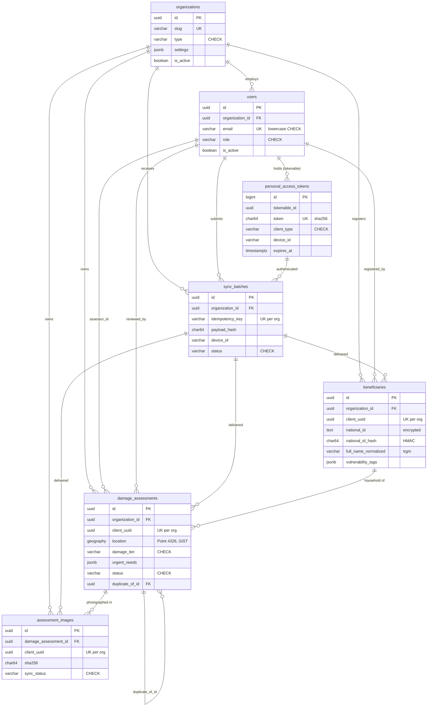

# Database Schema

Engine: **PostgreSQL 16** with **PostGIS 3.4** and **pg_trgm**. Every rule in this document is enforced by the database itself (foreign keys, `CHECK` constraints, unique and partial-unique indexes), not only by application code. Sync, deduplication and administrative tooling can therefore never persist an inconsistent row.

Source of truth: `backend/database/migrations/`.

---

## 1. Conventions

| Convention | Rule |
|---|---|
| Primary keys | `uuid`, generated by the application as **UUIDv7** (time-ordered, so B-tree inserts stay append-mostly). Exception: `personal_access_tokens.id` is `bigint` (Sanctum's `<id>|<secret>` token format). |
| Device identity | Field-originated tables carry a device-generated `client_uuid`, unique **per organization**. |
| Timestamps | `timestamptz` everywhere. Server time: `created_at`, `updated_at`, `synced_at`. Device time: `assessed_at`, `client_created_at`, `client_updated_at`. Device time is never used for ordering or security. |
| Deletion | Domain tables use soft deletes (`deleted_at`). `sync_batches` is an append-only audit log and is never soft-deleted. |
| Enumerations | Stored as `varchar` + `CHECK (col IN (…))`. Each constraint mirrors a PHP backed enum in `app/Enums` (table in §5). Adding a value requires a migration **and** an enum case. |
| JSON | `jsonb` with a `CHECK (jsonb_typeof(col) = 'array')` where the column must be a list. |
| Tenancy | Every tenant-owned table has `organization_id uuid NOT NULL REFERENCES organizations ON DELETE RESTRICT`. |
| Revisions | `revision integer ≥ 1` on field-editable tables, incremented by the device on each local edit; used by the sync engine to discard stale updates. |

---

## 2. Entity relationships

### Referential actions

| Foreign key | On delete | Rationale |
|---|---|---|
| `*.organization_id → organizations` | `RESTRICT` | A tenant with data cannot be hard-deleted; organizations are soft-deleted/deactivated. |
| `assessment_images.damage_assessment_id` | `CASCADE` | Images have no meaning without their assessment. |
| `damage_assessments.beneficiary_id`, `assessor_id`, `reviewed_by`, `duplicate_of_id`; `beneficiaries.registered_by`; `*.sync_batch_id`; `sync_batches.user_id`, `personal_access_token_id` | `SET NULL` | Audit/attribution links must not block deletion of the referenced row, and must not cascade-delete field data. |

---

## 3. Tables

### 3.1 `organizations` — tenants

| Column | Type | Notes |
|---|---|---|
| `id` | uuid PK | |
| `name` | varchar(255) | |
| `slug` | varchar(100) UNIQUE | `CHECK (slug ~ '^[a-z0-9]+(-[a-z0-9]+)*$')` |
| `type` | varchar(32) | `ngo`, `un_agency`, `government`, `community_based`, `private_contractor`, `donor` |
| `registration_number`, `contact_email`, `contact_phone` | nullable | |
| `settings` | jsonb, default `{}` | Per-tenant configuration |
| `is_active` | boolean, default true | Deactivation immediately invalidates all tokens of the tenant's users (enforced by the Sanctum guard callback) |
| `created_at`, `updated_at`, `deleted_at` | timestamptz | |

Indexes: `slug` (unique), `is_active`.

### 3.2 `users`

| Column | Type | Notes |
|---|---|---|
| `id` | uuid PK | |
| `organization_id` | uuid FK, NOT NULL | Each user belongs to exactly one tenant |
| `email` | varchar(255) UNIQUE | Globally unique (login identifier); `CHECK (email = lower(email))`, normalised by the model |
| `role` | varchar(32) | `admin`, `coordinator`, `field_agent`, `contractor`, `donor` |
| `locale` | varchar(8), default `ar` | |
| `is_active` | boolean | |
| `password` | varchar | bcrypt |
| `last_login_at` | timestamptz | |
| `email_verified_at`, `remember_token`, timestamps, `deleted_at` | | |

Indexes: `email` (unique), `(organization_id, role)`, `(organization_id, is_active)`.

Companion tables `password_reset_tokens` and `sessions` (with `user_id uuid`) are kept for framework compatibility; API authentication does not use sessions.

### 3.3 `personal_access_tokens` — Sanctum tokens

Standard Sanctum columns (`tokenable_type`, `tokenable_id` **uuid**, `name`, `token` = SHA-256 of the secret, `abilities` JSON, `last_used_at`, `expires_at`) plus:

| Column | Type | Notes |
|---|---|---|
| `client_type` | varchar(32) | `field_device` or `web_dashboard` |
| `device_id` | varchar(128), nullable | `CHECK (client_type <> 'field_device' OR device_id IS NOT NULL)` |
| `created_ip` | inet | Forensics for lost-device incidents |

Indexes: `token` (unique), `expires_at`, `(tokenable_type, tokenable_id)`, `(tokenable_type, tokenable_id, device_id)`.

See [authentication-rbac.md](../security/authentication-rbac.md) for the token lifecycle.

### 3.4 `sync_batches` — sync audit log and idempotency ledger

| Column | Type | Notes |
|---|---|---|
| `id` | uuid PK | |
| `organization_id` | uuid FK | |
| `user_id` | uuid FK, nullable | Submitting user |
| `personal_access_token_id` | bigint FK, nullable | Token that authenticated the batch |
| `idempotency_key` | varchar(128) | Device-generated; **`UNIQUE (organization_id, idempotency_key)`** |
| `payload_hash` | char(64) | SHA-256 hex of the canonical payload; `CHECK` lowercase hex. Detects key reuse with a different payload |
| `device_id`, `device_platform`, `app_version` | varchar | |
| `status` | varchar(32) | `received` → `processing` → `completed` / `partially_failed` / `failed` |
| `total_items`, `created_count`, `updated_count`, `skipped_count`, `failed_count` | integer ≥ 0 | `CHECK (created + updated + skipped + failed ≤ total)` |
| `result_summary` | jsonb | Synced / failed `client_uuid` lists returned to the device |
| `error_message` | text | |
| `client_sent_at` | timestamptz | Device clock |
| `received_at` | timestamptz NOT NULL | Server clock |
| `clock_skew_seconds` | integer | `received_at − client_sent_at`; positive = device clock behind |
| `processing_started_at`, `completed_at` | timestamptz | |
| `ip_address` | inet; `user_agent` text | |

Indexes: `(organization_id, received_at)`, `(device_id, received_at)`, `(user_id, received_at)`, `status`.

### 3.5 `beneficiaries` — households

| Column | Type | Notes |
|---|---|---|
| `id` | uuid PK | |
| `organization_id` | uuid FK | Registering organization |
| `client_uuid` | uuid, nullable | Null for records created on the web dashboard; `UNIQUE (organization_id, client_uuid)` |
| `sync_batch_id`, `registered_by` | uuid FK, nullable | |
| `national_id` | text, nullable | **Encrypted** (AES-256-CBC + HMAC via Laravel's encrypter) normalised 9-digit ID |
| `national_id_hash` | char(64), nullable | HMAC-SHA256 of the normalised ID; `CHECK ((national_id IS NULL) = (national_id_hash IS NULL))` |
| `full_name` | varchar(255) | As entered |
| `full_name_normalized` | varchar(255) | Arabic-normalised for fuzzy matching (see §4.3) |
| `gender` | varchar(16), nullable | `male`, `female` |
| `date_of_birth` | date | |
| `phone` | varchar(32) | |
| `governorate` | varchar(32), nullable | `north_gaza`, `gaza`, `deir_al_balah`, `khan_yunis`, `rafah` |
| `displacement_status` | varchar(32), nullable | `resident`, `displaced_shelter`, `displaced_host_family`, `displaced_tent`, `returnee` |
| `address_description` | text | Free text (formal addresses frequently no longer exist) |
| `household_size` | smallint | `1…100` |
| `children_count`, `elderly_count`, `disabled_count`, `pregnant_lactating_count` | smallint | Each `0…household_size`; `children_count + elderly_count ≤ household_size` (children are under 18 and elderly 60+, so the groups do not overlap) |
| `is_female_headed` | boolean | |
| `vulnerability_tags` | jsonb array | Values of `VulnerabilityTag`; `CHECK jsonb_typeof = 'array'` |
| `notes` | text | |
| `revision`, `client_created_at`, `client_updated_at`, `synced_at`, timestamps, `deleted_at` | | |

Indexes:

| Index | Definition | Purpose |
|---|---|---|
| `beneficiaries_org_national_id_hash_active_unique` | `UNIQUE (organization_id, national_id_hash) WHERE national_id_hash IS NOT NULL AND deleted_at IS NULL` | One **active** registration per person per organization. Registrations in different organizations are allowed and are resolved by Phase 3 deduplication. A soft-deleted registration does not block re-registration. |
| `beneficiaries_national_id_hash_index` | B-tree `(national_id_hash)` | Cross-organization identity lookup |
| `beneficiaries_full_name_normalized_trgm_index` | GIN `(full_name_normalized gin_trgm_ops)` | `%` / `similarity()` fuzzy matching |
| `beneficiaries_vulnerability_tags_index` | GIN `(vulnerability_tags)` | `?|` (any-of) tag filters |
| `(organization_id, governorate)`, `(organization_id, created_at)` | B-tree | Listing and reporting |

### 3.6 `damage_assessments`

| Column | Type | Notes |
|---|---|---|
| `id` | uuid PK | |
| `organization_id` | uuid FK | |
| `client_uuid` | uuid NOT NULL | `UNIQUE (organization_id, client_uuid)` |
| `sync_batch_id`, `beneficiary_id`, `assessor_id` | uuid FK, nullable | |
| `location` | **geography(Point, 4326)** NOT NULL | GiST index; `CHECK (NOT ST_IsEmpty(location::geometry))` |
| `location_accuracy_m` | numeric(8,2) | GPS accuracy reported by the device, ≥ 0 |
| `governorate` | varchar(32) | As in `beneficiaries` |
| `address_description` | text | |
| `structure_type` | varchar(32) | `residential_house`, `apartment_building`, `shelter`, `school`, `health_facility`, `commercial`, `religious`, `infrastructure`, `other` |
| `damage_tier` | varchar(16) | `none`, `minor`, `moderate`, `severe`, `destroyed` (ordinal 0–4 via `DamageTier::severity()`) |
| `habitability` | varchar(32) | `habitable`, `partially_habitable`, `uninhabitable` |
| `floors_count` | smallint, 0–200; `units_count` smallint, 0–2000 | |
| `urgent_needs` | jsonb array | `[{"category": "<NeedCategory>", "quantity": int?, "notes": string?}]` |
| `notes` | text | |
| `status` | varchar(32), default `submitted` | `submitted`, `under_review`, `verified`, `rejected`, `duplicate` |
| `priority_score` | numeric(6,2), 0–100 | Set by Phase 3 |
| `priority_level` | varchar(16) | `critical`, `high`, `medium`, `low` |
| `priority_calculated_at` | timestamptz | |
| `duplicate_of_id` | uuid FK → `damage_assessments` | `CHECK ((status = 'duplicate') = (duplicate_of_id IS NOT NULL) AND duplicate_of_id <> id)` |
| `reviewed_by`, `reviewed_at` | | |
| `revision`, `assessed_at` (NOT NULL), `client_created_at`, `client_updated_at`, `synced_at`, timestamps, `deleted_at` | | |

Indexes:

| Index | Purpose |
|---|---|
| `damage_assessments_location_spatialindex` — GiST `(location)` | `ST_DWithin`, `&&`, KNN `<->` |
| `UNIQUE (organization_id, client_uuid)` | Idempotent upsert |
| `(organization_id, status)` | Triage queues |
| `(organization_id, assessed_at)` | Time-window reporting |
| `(organization_id, priority_level, priority_score)` | Priority queues |
| `(damage_tier, governorate)` | Cross-tenant heatmap aggregation |
| `(beneficiary_id)`, `(assessor_id)`, `(duplicate_of_id)` | FK lookups |
| GIN `(urgent_needs)` | `urgent_needs @> '[{"category":"water"}]'` |

### 3.7 `assessment_images`

| Column | Type | Notes |
|---|---|---|
| `id` | uuid PK | |
| `organization_id` | uuid FK | Denormalised for tenant scoping without a join |
| `damage_assessment_id` | uuid FK, `ON DELETE CASCADE` | |
| `client_uuid` | uuid NOT NULL | `UNIQUE (organization_id, client_uuid)` |
| `sync_batch_id` | uuid FK, nullable | |
| `disk` | varchar(32) | Laravel filesystem disk (`ASSESSMENT_MEDIA_DISK`) |
| `storage_path` | varchar(1024), nullable | Null until the binary is verified |
| `original_filename`, `mime_type` | varchar | |
| `size_bytes` | bigint > 0; `width`, `height` integer > 0 | |
| `sha256` | char(64) NOT NULL | Client-declared content hash; `CHECK` lowercase hex |
| `location` | geography(Point, 4326), nullable | EXIF / capture location; GiST index |
| `captured_at` | timestamptz | Device clock |
| `caption` | text | |
| `sync_status` | varchar(32) | `pending_upload`, `uploaded`, `processing`, `processed`, `failed` |
| `sync_attempts` | smallint ≥ 0; `last_sync_error` text | |
| `uploaded_at`, `processed_at`, timestamps, `deleted_at` | | |

`CHECK (sync_status NOT IN ('uploaded','processing','processed') OR (storage_path IS NOT NULL AND uploaded_at IS NOT NULL))`.

Indexes: `(damage_assessment_id)`, `(organization_id, sync_status)`, `(sha256)` (detects the same photo attached twice), GiST `(location)`.

---

## 4. Derived and protected columns

### 4.1 Columns devices can never write

`organization_id`, `status`, `priority_*`, `duplicate_of_id`, `reviewed_*`, `sync_batch_id`, `synced_at`, `revision` (server-managed), `national_id_hash`, `full_name_normalized`, image `disk` / `storage_path` / `sync_status`. These are excluded from every model's `$fillable` and are set only by server-side services.

### 4.2 `GeoPoint` cast

`location` columns are cast to `App\Support\Geo\GeoPoint`. Writes are bound as EWKT (`SRID=4326;POINT(lng lat)`), reads are parsed from PostGIS hex EWKB. See [system-overview.md §5](system-overview.md#5-postgis-spatial-architecture).

### 4.3 Name normalisation

`full_name_normalized` is recomputed on every save from `full_name` by `App\Support\Text\ArabicNameNormalizer`:

1. strip harakat (U+064B–U+065F), superscript alef (U+0670) and tatweel (U+0640);
2. `أ إ آ ٱ → ا`, `ى → ي`, `ة → ه`, `ؤ → و`, `ئ → ي`, drop standalone `ء`;
3. lowercase Latin script;
4. replace punctuation with spaces and collapse whitespace.

So `أحمد إبراهيم أبو شعبان` and `احمد ابراهيم ابو شعبان` index identically, and `Beneficiary::whereNameSimilarTo()` uses the trigram GIN index via the `%` operator before applying the caller's stricter `similarity()` threshold (0.3–1.0).

---

## 5. Enum ↔ constraint map

| PHP enum (`app/Enums`) | Constraint |
|---|---|
| `OrganizationType` | `organizations_type_check` |
| `UserRole` | `users_role_check` |
| `ClientType` | `personal_access_tokens_client_type_check` |
| `SyncBatchStatus` | `sync_batches_status_check` |
| `Gender` | `beneficiaries_gender_check` |
| `Governorate` | `beneficiaries_governorate_check`, `damage_assessments_governorate_check` |
| `DisplacementStatus` | `beneficiaries_displacement_status_check` |
| `VulnerabilityTag` | validated in the application (jsonb contents) |
| `StructureType` | `damage_assessments_structure_type_check` |
| `DamageTier` | `damage_assessments_damage_tier_check` |
| `HabitabilityStatus` | `damage_assessments_habitability_check` |
| `AssessmentStatus` | `damage_assessments_status_check` |
| `PriorityLevel` | `damage_assessments_priority_check` |
| `NeedCategory` | validated in the application (jsonb contents) |
| `ImageSyncStatus` | `assessment_images_sync_status_check` |

---

## 6. National ID protection and key management

| Layer | Mechanism |
|---|---|
| At rest | `national_id` is encrypted with `APP_KEY` (Laravel `encrypted` cast). The plaintext never reaches the database. |
| Lookup | `national_id_hash = HMAC-SHA256(NATIONAL_ID_HASH_KEY, normalised_id)`. A plain SHA-256 would be reversible: there are only 10⁹ nine-digit IDs. |
| Normalisation | Arabic-Indic (`٠–٩`) and Extended Arabic-Indic (`۰–۹`) digits → ASCII, separators stripped, left-padded to 9 digits, before both encryption and hashing. |
| Validation | `NationalId::isValid()` implements the Palestinian ID check digit (Luhn variant). Phase 2 request validation uses it. |
| Serialisation | `national_id`, `national_id_hash` and `full_name_normalized` are `$hidden`; `masked_national_id` (`*****4567`) is available for display. Decrypted IDs are returned by the API only to tokens with `beneficiaries:pii`. |

**Key rules**

- `NATIONAL_ID_HASH_KEY` must be ≥ 32 bytes and different from `APP_KEY`. The application refuses to hash with a missing or short key.
- `APP_KEY` can be rotated with Laravel's `APP_PREVIOUS_KEYS` mechanism without touching the hash index.
- Rotating `NATIONAL_ID_HASH_KEY` requires re-hashing every row in a maintenance window: decrypt `national_id`, compute the new HMAC, update `national_id_hash` in batches, then switch the key. Until then, lookups with the new key miss existing rows.
- Both keys belong in the secret manager of the deployment environment and never in the repository.

---

## 7. Migration order and prerequisites

| Order | Migration | Notes |
|---|---|---|
| 1 | `0000_01_01_000000_enable_postgres_extensions` | `CREATE EXTENSION IF NOT EXISTS postgis, pg_trgm`. In managed databases where the app role is not a superuser, a DBA creates them once and this migration does nothing. `down()` deliberately leaves the extensions in place. |
| 2 | `0000_01_01_000001_create_organizations_table` | |
| 3 | `0001_01_01_000000_create_users_table` | users, password_reset_tokens, sessions |
| 4 | `0001_01_01_000001/2` | Framework cache and queue tables |
| 5 | `2026_10_12_000100_create_personal_access_tokens_table` | UUID morphs, client type, device binding |
| 6 | `2026_10_12_000200_create_sync_batches_table` | |
| 7 | `2026_10_12_000300_create_beneficiaries_table` | |
| 8 | `2026_10_12_000400_create_damage_assessments_table` | |
| 9 | `2026_10_12_000500_create_assessment_images_table` | |

`migrate:fresh` is safe on PostGIS databases: Laravel's PostgreSQL schema builder excludes the extension-owned `spatial_ref_sys` table from `dropAllTables`.
