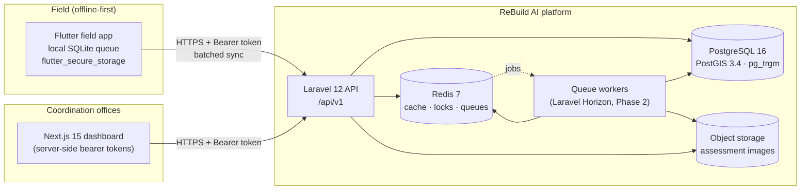
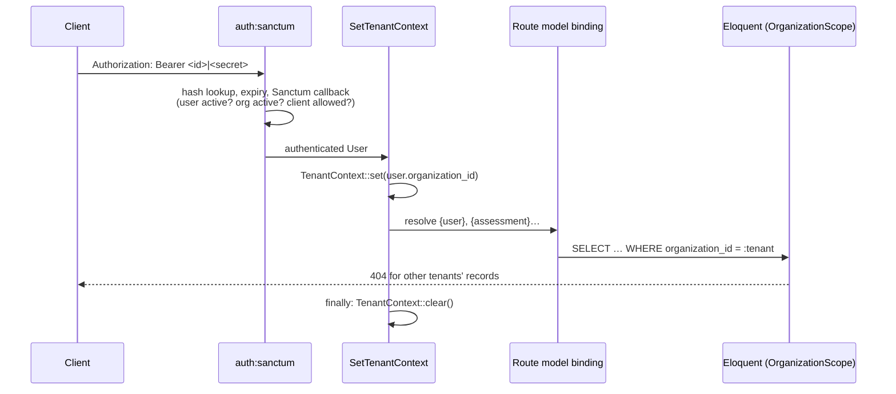
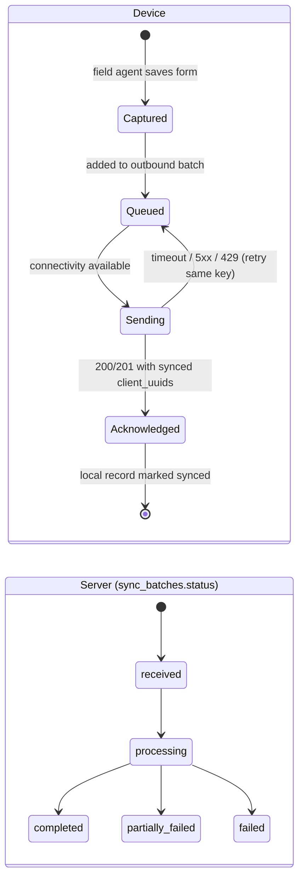
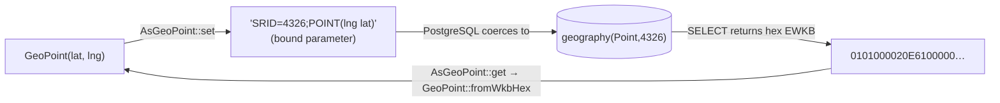

# System Overview

ReBuild AI coordinates field damage surveys, relief delivery and reconstruction tracking across multiple humanitarian organizations working in the Gaza Strip. It is designed for an environment where connectivity is intermittent for days at a time, power is unreliable, and field devices are regularly lost or seized.

This document describes the architecture established in **Phase 1** (foundation, data layer, authentication) and the design contracts later phases build on. Sections marked **(Phase 2+)** describe behaviour that is designed here but implemented later.

---

## 1. Operating constraints and how the architecture answers them

| Constraint | Architectural response |
|---|---|
| Field devices are offline for hours to weeks | Offline-first clients; all field records carry a device-generated `client_uuid`; batches are idempotent and safe to retry indefinitely. |
| Uplinks are slow, expensive and drop mid-request | Small JSON batches separated from image binaries; image metadata syncs first, binaries follow when bandwidth allows. |
| Device clocks drift and are sometimes wrong by days | Client timestamps (`assessed_at`, `client_created_at`) are stored separately from server timestamps (`created_at`, `synced_at`); per-batch clock skew is recorded. |
| Phones get lost, stolen or confiscated | Device-bound tokens with a reduced ability ceiling; one live token per device; self-service and administrator revocation; no decrypted national IDs on field tokens. |
| Many organizations serve the same households | Strict row-level tenant isolation for users, plus a system-level cross-organization deduplication pass (Phase 3) that never runs as a user. |
| Beneficiary data is highly sensitive | National IDs encrypted at rest and indexed only by a keyed HMAC; PII hidden from serialization by default. |
| Many teams share one satellite/NAT uplink | Login rate limits keyed per account **and** per IP, with a generous per-IP budget. |

---

## 2. Components



| Component | Responsibility | Status |
|---|---|---|
| Laravel 12 API (`backend/`) | Authentication, RBAC, tenant isolation, sync ingestion, triage APIs | Phase 1: auth + data layer |
| PostgreSQL + PostGIS | System of record; spatial indexing; constraint enforcement | Phase 1 |
| Redis | Cache, rate-limit counters, idempotency locks, queues | Phase 1 config; locks/queues Phase 2 |
| Horizon workers | Image verification, deduplication, priority scoring | Phase 2–3 |
| Flutter field app | Offline capture, local queue, batch sync | Separate track |
| Next.js dashboard | Triage, GIS dashboards, reconstruction tracking | Separate track |

### Repository layout

```
ReBuild AI/
├── backend/                      Laravel 12 API
│   ├── app/
│   │   ├── Casts/AsGeoPoint.php          geography(Point,4326) <-> GeoPoint
│   │   ├── Enums/                        domain enums mirroring DB CHECK constraints, RBAC enums
│   │   ├── Models/                       Eloquent models
│   │   │   ├── Concerns/BelongsToOrganization.php   row-level tenancy
│   │   │   └── Concerns/HasSpatialLocation.php      PostGIS query scopes
│   │   ├── Services/Auth/TokenIssuer.php token issuance / rotation / revocation
│   │   ├── Support/                      GeoPoint, NationalId, NationalIdHasher, ArabicNameNormalizer
│   │   └── Tenancy/TenantContext.php     active-tenant holder (scoped binding)
│   ├── database/migrations/              schema (see database-schema.md)
│   └── docker/                           dev/CI image and DB init
├── docs/                         architecture, security, (later) api, testing, analysis
└── docker-compose.yml            PostGIS, Redis, app
```

---

## 3. Multi-tenancy

ReBuild AI uses **single-database, row-level multi-tenancy**. Every tenant-owned table carries a non-null `organization_id` foreign key.



Guarantees provided by `App\Models\Concerns\BelongsToOrganization`:

1. **Read isolation** – `OrganizationScope` adds `WHERE <table>.organization_id = :tenant` to every query while a tenant is active, including route-model binding (the `tenant` middleware is placed in the priority list directly after authentication, i.e. before `SubstituteBindings`).
2. **Write isolation** – on `creating`, a missing `organization_id` is filled from the context; an explicit `organization_id` that differs from the context throws `TenantViolationException`.
3. **Immutability** – `organization_id` can never be changed after creation.
4. **No orphan rows** – creating a tenant-owned record with neither an explicit organization nor an active context throws.
5. **Leak-free lifetime** – `TenantContext` is a *scoped* container binding (reset between Octane requests and between queued jobs), and the middleware clears it in a `finally` block.

When **no** tenant is active (console commands, system jobs), queries are not filtered. This is deliberate: Phase 3 deduplication must compare records across organizations. Such code must either call `TenantContext::runAs($organization, …)` or scope explicitly with `Model::forOrganization($organization)`; `TenantContext::runWithoutTenant(…)` makes system-wide intent explicit and restores the previous context afterwards.

`organization_id` and `role` are **not mass assignable** on any model, so request payloads can never move a record or escalate a role.

---

## 4. Offline-first synchronisation lifecycle

### 4.1 Identity of field records

| Concern | Mechanism |
|---|---|
| Record identity before sync | Device generates a UUIDv4 `client_uuid` at capture time. |
| Server identity | Server assigns its own UUIDv7 primary key (`id`), time-ordered for index locality. |
| Idempotent upsert | `UNIQUE (organization_id, client_uuid)` on `beneficiaries`, `damage_assessments`, `assessment_images`. |
| Why not use `client_uuid` as the primary key? | The server must own identity: a malicious or buggy client could otherwise choose an ID that collides with (and probe or overwrite) another tenant's record. Scoping the uniqueness to the organization makes cross-tenant collisions impossible by construction. |
| Linking related records offline | Payloads reference parents by `client_uuid`; the sync engine resolves them to server `id`s inside the batch transaction (Phase 2). |

### 4.2 Batch lifecycle



1. **Capture** – the field app writes the record to local storage with a `client_uuid`, device timestamps (`assessed_at`, `client_created_at`, `client_updated_at`) and a local `revision` counter.
2. **Batching** – queued records are grouped into a batch with a device-generated **idempotency key** (UUID) and a SHA-256 **payload hash**.
3. **Submission (Phase 2)** – `POST /api/v1/sync/batch` with a field-device token carrying `sync:push`.
4. **Idempotency (Phase 2)** – the server takes a Redis lock on `(organization_id, idempotency_key)` and checks `sync_batches`:
   - key unseen → create a `sync_batches` row (`received`) and ingest;
   - key seen with the **same** `payload_hash` → return the stored result (a safe retry after a dropped response);
   - key seen with a **different** `payload_hash` → reject with `409 Conflict` (client bug; never silently merged).
5. **Ingestion (Phase 2)** – one database transaction upserts records by `(organization_id, client_uuid)`, resolves parent references, and stores the batch's counters and `result_summary` (lists of synced/failed `client_uuid`s).
6. **Acknowledgement** – the response lists the synced `client_uuid`s; only these are marked synced on the device. Unlisted records stay queued.
7. **Background work (Phase 2–3)** – `ProcessSyncBatchJob` (Horizon) handles image verification, deduplication and priority scoring.

The `UNIQUE (organization_id, idempotency_key)` constraint on `sync_batches` is the durable backstop for the Redis lock: even if Redis is flushed mid-flight, two concurrent submissions of the same batch cannot both be recorded.

### 4.3 Images: two-phase upload

Image **metadata** (`client_uuid`, `sha256`, capture time and location) travels inside the batch and creates an `assessment_images` row in `pending_upload`. The **binary** follows separately when bandwidth allows and is accepted only if its SHA-256 matches the declared hash.

```
pending_upload ──binary verified──▶ uploaded ──▶ processing ──▶ processed
       │                                              │
       └──────────── hash mismatch / error ───────────┴──▶ failed ──retry──▶ pending_upload
```

A database `CHECK` guarantees that any row in `uploaded`, `processing` or `processed` has a `storage_path` and `uploaded_at`.

### 4.4 Conflicts and revisions

- While an assessment is `submitted`, a later sync of the same `client_uuid` may overwrite field-captured attributes if its `revision` is higher (`AssessmentStatus::isEditableFromDevice()`).
- Once a coordinator moves it to `under_review`, `verified`, `rejected` or `duplicate`, the **server wins**; device updates are reported back as skipped.
- Server-owned columns (status, priority, duplicate flags, reviewer) are not mass assignable, so they cannot be set from device payloads.

### 4.5 Clock drift

Device timestamps are never used for server ordering or security decisions. Each batch records `client_sent_at` and `received_at`; `clock_skew_seconds = received_at − client_sent_at` (positive when the device clock is behind). Phase 2 uses the skew to flag implausible `assessed_at` values instead of rewriting them.

### 4.6 Authentication while offline

Field tokens live for 30 days (configurable). Devices should call `POST /auth/refresh` whenever they are online, which rotates the token and restarts its lifetime. A token that expires while the device is offline requires the agent to sign in again; **the local outbound queue must survive re-authentication** and be sent with the new token. See [authentication-rbac.md](../security/authentication-rbac.md).

---

## 5. PostGIS spatial architecture

### 5.1 Type choice

Locations are stored as **`geography(Point, 4326)`**, not `geometry`:

- Field GPS produces WGS84 longitude/latitude (EPSG:4326).
- `geography` computes distances and radii in **metres on the WGS84 spheroid**, which is exactly what deduplication ("reports within 15 m") and coverage queries need, without projecting to a local CRS.
- The geography type rejects out-of-range coordinates at the database level; an extra `CHECK` rejects `POINT EMPTY`, which some devices emit without a GPS fix.

### 5.2 Read and write path



- `App\Support\Geo\GeoPoint` is an immutable, validated value object (latitude −90…90, longitude −180…180, finite). It serialises to `{"lat": …, "lng": …}` and to GeoJSON (`[lng, lat]` order).
- Writes are plain prepared-statement bindings of EWKT; no raw SQL fragments are built from user input.
- Reads parse little/big-endian EWKB and ISO WKB, including Z/M variants, and reject non-point geometries and foreign SRIDs.
- Coordinates are emitted with 10 decimal places (~0.01 mm), so a stored point round-trips without precision loss or spurious dirty-checks.

### 5.3 Indexes and query patterns

Each spatial column has a **GiST** index (`damage_assessments_location_spatialindex`, `assessment_images_location_spatialindex`). Scopes in `App\Models\Concerns\HasSpatialLocation` are written so the planner can use it:

| Scope | SQL predicate | Index use | Typical caller |
|---|---|---|---|
| `withinRadius($point, $metres)` | `ST_DWithin(location, :p, :m)` | GiST (bbox expansion + recheck) | Phase 3 deduplication (15 m) |
| `orderByDistance($point)` | `ORDER BY location <-> :p` | GiST KNN | nearest assessments |
| `withDistanceFrom($point)` | `ST_Distance(location, :p) AS distance_m` | — (projection) | UI annotations |
| `withinBoundingBox(…)` | `location && ST_MakeEnvelope(…)::geography` | GiST | map viewports, clustering (Phase 4) |
| `withinGeoJsonArea($polygon)` | `ST_Covers(:area, location)` | GiST | governorate / neighbourhood filters |

Radius queries are capped at 50 km; larger areas must use bounding boxes or polygons. The test suite asserts that a radius query plan uses the GiST index.

### 5.4 Other indexes used by later phases

| Index | Purpose |
|---|---|
| `beneficiaries.national_id_hash` (B-tree) | Exact cross-organization identity matching (Phase 3) |
| `beneficiaries_full_name_normalized_trgm_index` (GIN, `gin_trgm_ops`) | Fuzzy name matching across spelling variants (Phase 3) |
| `beneficiaries.vulnerability_tags` (GIN) | Vulnerability filters for prioritisation (Phase 3) |
| `damage_assessments.urgent_needs` (GIN) | Need-category containment queries (`@>`) |
| `(organization_id, priority_level, priority_score)` | Triage queues (Phase 3–4) |

---

## 6. Running locally

Prerequisites: Docker Desktop (or Docker Engine + Compose v2).

```bash
docker compose up -d postgres redis
```

```bash
docker compose run --rm app composer install
```

```bash
docker compose run --rm app php artisan migrate
```

```bash
docker compose run --rm app php artisan rebuild:organization:create "Example Relief" --type=ngo --admin-name="Site Admin" --admin-email=admin@example.org
```

```bash
docker compose run --rm app php artisan test
```

The test suite always targets the `rebuild_testing` database (forced in `phpunit.xml`), created automatically the first time the PostGIS volume is initialised. Demo data for local exploration: `docker compose run --rm app php artisan db:seed` (refuses to run in production; prints one generated password per role).

Required secrets in `backend/.env`: `APP_KEY` and `NATIONAL_ID_HASH_KEY` (see [database-schema.md §6](database-schema.md#6-national-id-protection-and-key-management)).

---

## 7. Phase map

| Phase | Builds on these Phase 1 contracts |
|---|---|
| 2 – Sync engine | `client_uuid` uniqueness, `sync_batches` idempotency key + payload hash, `sync:push` ability, `AsGeoPoint` write path, image `sync_status` machine |
| 3 – Deduplication & prioritisation | `withinRadius`, `national_id_hash`, trigram index, `duplicate_of_id` + consistency check, `priority_*` columns, `TenantContext::runWithoutTenant` |
| 4 – Operations & reconstruction | `assessments:review`, `relief:*`, `reconstruction:*` abilities, bounding-box scopes, tenant-scoped route binding |
