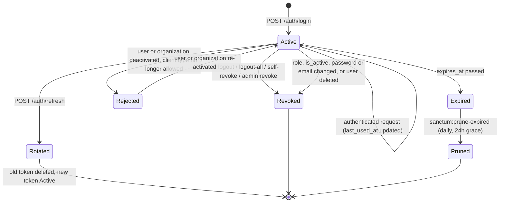

<!-- Abilities and role/client rules are pinned by backend/tests/Unit/Enums/RbacMatrixTest.php; update both together. -->

# Authentication & RBAC

ReBuild AI authenticates every API client with **Laravel Sanctum personal access tokens** sent as `Authorization: Bearer` headers. Authorization has three layers, each enforced on every request:

1. **Token validity**: the token exists, has not expired, and its user and organization are still allowed to use it.
2. **Token abilities**: the token carries the ability the route requires (Sanctum `ability` / `abilities` middleware).
3. **Tenant isolation**: every query and route-model binding is restricted to the caller's organization ([system-overview.md §3](../architecture/system-overview.md#3-multi-tenancy)).

Phase 4 adds per-record **policies** (for example, "a contractor sees only assessments assigned to them") on top of these layers. Policies never grant more than the token's abilities allow.

---

## 1. Why bearer tokens only

Sanctum also supports cookie-based SPA sessions. These are **disabled** (`config/sanctum.php`: `'guard' => []`), for two reasons:

- A session-authenticated request is given a `TransientToken`, for which `tokenCan()` returns **true for every ability**. That would bypass the permissions matrix entirely.
- The Next.js dashboard calls the API from its server side, where bearer tokens are natural, and the Flutter field app cannot use cookies reliably across long offline periods.

---

## 2. Token anatomy

```
<token id>|rbai_<40 random chars><crc32b checksum>
└──┬─────┘ └────────────────────┬────────────────┘
 row id              secret (shown once)
```

| Property | Value |
|---|---|
| Storage | Only `sha256(secret)` is stored (`personal_access_tokens.token`). The plaintext is returned once, in the login or refresh response. |
| Prefix | `rbai_` (`SANCTUM_TOKEN_PREFIX`). Lets GitHub and other secret scanners detect leaked tokens. |
| Response headers | Token responses carry `Cache-Control: no-store` and `Pragma: no-cache`. |
| Bound attributes | `client_type`, `device_id` (field devices), `abilities`, `expires_at`, `created_ip`. |

### Client storage requirements

| Client | Requirement |
|---|---|
| Flutter field app | Store in `flutter_secure_storage` (Android Keystore / iOS Keychain). Never in shared preferences, SQLite or logs. Clear it on logout or on a 401 that persists after a refresh attempt. |
| Next.js dashboard | Keep the token server-side, in an encrypted, `HttpOnly`, `Secure`, `SameSite=Strict` session cookie of the Next.js app. Never expose it to browser JavaScript. |

---

## 3. Client types

| | `field_device` | `web_dashboard` |
|---|---|---|
| Intended client | Flutter app on a field phone or tablet | Next.js coordination dashboard |
| Lifetime | **30 days** (`AUTH_FIELD_DEVICE_TOKEN_TTL_MINUTES=43200`) | **12 hours** (`AUTH_WEB_DASHBOARD_TOKEN_TTL_MINUTES=720`) |
| `device_id` | Required (8–128 chars, `[A-Za-z0-9._:-]`), enforced by validation and a DB `CHECK` | Not used |
| Live tokens per device | Exactly one: signing in again on the same device replaces the old token | n/a |
| Ability ceiling | Field abilities only (see §5) | All abilities of the role |

Field tokens are long-lived because agents can be offline for weeks. To limit what a lost or seized phone exposes, they are capped by a **ceiling**: no review, management, audit or decrypted-PII abilities, whatever the user's role.

A user may hold at most `AUTH_MAX_ACTIVE_TOKENS_PER_USER` (default **5**) tokens. Issuing one more revokes the oldest.

---

## 4. Roles

All roles are **scoped to one organization**. No user role can read or write another tenant's data. Cross-organization processing (Phase 3 deduplication) runs as a system process, not as a user.

| Role | Purpose | Allowed clients |
|---|---|---|
| `admin` | Organization administrator: users, settings, full oversight | web |
| `coordinator` | Triage, review, relief and reconstruction management | field, web |
| `field_agent` | Registers households, captures damage assessments | field |
| `contractor` | Executes reconstruction work and reports progress | field, web |
| `donor` | Read-only oversight of aggregated results | web |

A login from a client type the role may not use returns **403**.

---

## 5. Permissions matrix

A token's abilities are **the role's abilities ∩ the client type's ceiling**, computed at issuance (`UserRole::abilitiesFor()`).

| Ability | Grants | Admin | Coordinator | Field agent | Contractor | Donor | Field-device ceiling |
|---|---|:-:|:-:|:-:|:-:|:-:|:-:|
| `profile:read` | Own profile and token info | ✔ | ✔ | ✔ | ✔ | ✔ | ✔ |
| `sync:push` | Submit offline batches | ✔ | ✔ | ✔ | ✔ | | ✔ |
| `sync:pull` | Download reference data / assignments | ✔ | ✔ | ✔ | ✔ | | ✔ |
| `beneficiaries:read` | Read households (IDs masked) | ✔ | ✔ | ✔ | | | ✔ |
| `beneficiaries:write` | Register / edit households | ✔ | ✔ | ✔ | | | ✔ |
| `beneficiaries:pii` | Read decrypted national IDs | ✔ | ✔ | | | | ✘ |
| `assessments:read` | Read damage assessments | ✔ | ✔ | ✔ | ✔ | | ✔ |
| `assessments:write` | Create / edit assessments | ✔ | ✔ | ✔ | | | ✔ |
| `assessments:review` | Verify, reject, mark duplicates | ✔ | ✔ | | | | ✘ |
| `images:upload` | Upload assessment / progress photos | ✔ | ✔ | ✔ | ✔ | | ✔ |
| `relief:read` | Read relief distributions | ✔ | ✔ | | | | ✘ |
| `relief:manage` | Allocate and dispatch relief | ✔ | ✔ | | | | ✘ |
| `reconstruction:read` | Read reconstruction projects | ✔ | ✔ | | ✔ | ✔ | ✔ |
| `reconstruction:update` | Report milestones / progress | ✔ | | | ✔ | | ✔ |
| `reconstruction:manage` | Create projects, assign contractors | ✔ | ✔ | | | | ✘ |
| `reports:read` | Aggregated dashboards and exports | ✔ | ✔ | | | ✔ | ✘ |
| `audit:read` | Sync batch audit log | ✔ | ✔ | | | | ✘ |
| `users:manage` | Manage users, revoke their tokens | ✔ | | | | | ✘ |
| `organization:manage` | Organization settings | ✔ | | | | | ✘ |

### Effective field-device abilities

| Role | Abilities on a `field_device` token |
|---|---|
| Coordinator | `profile:read`, `sync:push`, `sync:pull`, `beneficiaries:read`, `beneficiaries:write`, `assessments:read`, `assessments:write`, `images:upload`, `reconstruction:read` |
| Field agent | `profile:read`, `sync:push`, `sync:pull`, `beneficiaries:read`, `beneficiaries:write`, `assessments:read`, `assessments:write`, `images:upload` |
| Contractor | `profile:read`, `sync:push`, `sync:pull`, `assessments:read`, `images:upload`, `reconstruction:read`, `reconstruction:update` |

Admins and donors cannot obtain field-device tokens.

### Using abilities in routes

```php
Route::post('sync/batch', [SyncController::class, 'storeBatch'])
    ->middleware('abilities:'.TokenAbility::SyncPush->value);            // all listed abilities required

Route::get('assessments', [AssessmentController::class, 'index'])
    ->middleware('ability:'.TokenAbility::AssessmentsRead->value);       // any listed ability suffices
```

Inside application code, use `$user->hasAbility(TokenAbility::X)`, which checks the current token, or falls back to the role definition outside HTTP. A missing ability returns **403** (`Invalid ability provided.`).

---

## 6. Token lifecycle



### 6.1 Issuance: `POST /api/v1/auth/login`

Request:

```json
{
  "email": "agent@example.org",
  "password": "********",
  "client_type": "field_device",
  "device_name": "Samsung A14 – Khan Yunis team",
  "device_id": "android-7f3a9c2e41b8"
}
```

`201 Created`:

```json
{
  "data": {
    "token_type": "Bearer",
    "access_token": "42|rbai_…",
    "expires_at": "2026-11-11T08:00:00+00:00",
    "client_type": "field_device",
    "abilities": ["profile:read", "sync:push", "sync:pull", "beneficiaries:read", "beneficiaries:write", "assessments:read", "assessments:write", "images:upload"],
    "user": {
      "id": "0199…",
      "name": "…",
      "email": "agent@example.org",
      "phone": null,
      "role": "field_agent",
      "locale": "ar",
      "is_active": true,
      "last_login_at": "2026-10-12T08:00:00+00:00",
      "organization": { "id": "0199…", "name": "…", "slug": "…", "type": "ngo", "is_active": true }
    }
  }
}
```

| Status | Meaning |
|---|---|
| `201` | Token issued |
| `422` | Validation error, or wrong email/password. Both credential failures return the same message, `errors.email`. |
| `403` | Correct credentials, but the user or organization is disabled, or the role may not use this client type |
| `429` | Rate limit exceeded (`Retry-After` header) |

Protections:

- **Rate limits**: 5 attempts per minute per (email, IP), plus 60 per minute per IP. The per-IP budget is generous because field teams often share one satellite or NAT uplink.
- **No account enumeration**: unknown emails cost a full bcrypt computation, so response timing does not reveal whether the account exists, and the error message is identical.
- **Transparent rehash**: if the bcrypt cost changes, the password is rehashed on login without revoking the user's other tokens.
- **Email normalisation**: emails are matched lower-cased and trimmed.

### 6.2 Use

```
Authorization: Bearer 42|rbai_…
Accept: application/json        (optional; the API always answers JSON)
```

On every request, the Sanctum guard callback (`AppServiceProvider::configureSanctum`) rejects the token unless:

- `expires_at` is in the future;
- the user exists, is not soft-deleted, and `is_active = true`;
- the user's organization exists, is not soft-deleted, and `is_active = true`;
- the user's role is still allowed to use the token's `client_type`.

Deactivating an organization therefore cuts off all of its users **immediately**, without deleting tokens. Re-activating restores them.

### 6.3 Rotation: `POST /api/v1/auth/refresh`

Field apps should refresh whenever they regain connectivity, and dashboards before `expires_at`. Refresh:

1. deletes the presented token;
2. issues a new token for the same `client_type` and `device_id`, with abilities **recomputed from the current role** and a fresh lifetime.

Both steps run in one transaction. The response has the same shape as login (`200 OK`). If the account is no longer allowed to use the client, the presented token is revoked and `403` is returned.

### 6.4 Revocation

| Endpoint / event | Effect |
|---|---|
| `POST /api/v1/auth/logout` | Revokes the presented token (`204`). |
| `POST /api/v1/auth/logout-all` | Revokes every token of the caller (`204`). |
| `GET /api/v1/auth/tokens` | Lists the caller's unexpired tokens: id, name, client type, device id, abilities, last used, expiry, `is_current`. Never returns secrets. |
| `DELETE /api/v1/auth/tokens/{id}` | Revokes one of the caller's own tokens, for example a lost phone (`204`). Another user's token id returns `404`. |
| `DELETE /api/v1/users/{user}/tokens` | Requires `users:manage`. Revokes all tokens of a user **in the same organization** (`200`, `{"data":{"revoked_count":n}}`). Users of other organizations return `404`. Logged as `auth.tokens.revoked_by_admin`. |
| Change of `role`, `is_active`, `password` or `email` | All the user's tokens are deleted (`User::booted`). |
| User soft-deleted | All the user's tokens are deleted. |

### 6.5 Expiry and pruning

Expired tokens are rejected immediately. `sanctum:prune-expired --hours=24` runs daily (`routes/console.php`) and keeps a 24-hour grace window for incident forensics.

### 6.6 Offline behaviour of field devices

| Situation | Expected client behaviour |
|---|---|
| Online | Call `/auth/refresh` at most once per session start to keep the 30-day window rolling. |
| Offline | Keep capturing. Tokens are not needed until the next sync. |
| Token expired while offline | `401` on first sync: prompt for credentials, log in **with the same `device_id`**, then send the queued batches. **Never discard the outbound queue on a 401.** |
| `403` on login or refresh | Account or organization disabled: stop syncing, keep the queue encrypted on the device, and tell the user to contact their coordinator. |

---

## 7. Request pipeline

```
ForceJsonResponse → throttle:auth-login | auth:sanctum → tenant (SetTenantContext) → throttle:api → SubstituteBindings → ability/abilities → controller
```

- `ForceJsonResponse` makes every `/api/*` response JSON, including `401`, `403`, `404`, `422` and `429`. No HTML error pages or login redirects.
- `SetTenantContext` is placed in the middleware priority list directly after authentication, so route-model bindings (`{user}`) are already tenant-filtered when they resolve.
- `throttle:api` allows 240 requests per minute per user (`API_RATE_LIMIT_PER_MINUTE`).

---

## 8. Operational runbook

| Incident | Action |
|---|---|
| Field phone lost or seized | The user revokes it from the dashboard (`DELETE /auth/tokens/{id}`), or an admin calls `DELETE /users/{user}/tokens`. Field tokens never carry `beneficiaries:pii`, so decrypted national IDs were never available to that device through the API. |
| Staff member leaves | Admin sets `is_active = false` (tokens are deleted automatically) or soft-deletes the user. |
| Partner organization compromised or offboarded | Set `organizations.is_active = false`. All of its users are cut off at the guard on their next request. |
| Suspected credential stuffing | Check `429` rates in the logs. Lower `AUTH_LOGIN_ATTEMPTS_PER_ACCOUNT` or `AUTH_LOGIN_ATTEMPTS_PER_IP` if needed. |
| Leaked token reported by a secret scanner | The `rbai_` prefix identifies it. Its numeric prefix is the token row id: delete that row and investigate `created_ip` / `last_used_at`. |

### Provisioning

Organizations and their first administrator are created from the server console only. There is deliberately no public sign-up.

```bash
php artisan rebuild:organization:create "Example Relief" --type=ngo --admin-name="Site Admin" --admin-email=admin@example.org
```

The command prompts for a password (minimum 12 characters, mixed case, digits) or generates one and prints it once.

---

## 9. Configuration reference

| Variable | Default | Meaning |
|---|---|---|
| `SANCTUM_TOKEN_PREFIX` | `rbai_` | Secret-scanning prefix |
| `AUTH_FIELD_DEVICE_TOKEN_TTL_MINUTES` | `43200` (30 d) | Field token lifetime |
| `AUTH_WEB_DASHBOARD_TOKEN_TTL_MINUTES` | `720` (12 h) | Dashboard token lifetime |
| `AUTH_MAX_ACTIVE_TOKENS_PER_USER` | `5` | Older tokens beyond this are revoked |
| `AUTH_LOGIN_ATTEMPTS_PER_ACCOUNT` | `5` / min | Per (email, IP) |
| `AUTH_LOGIN_ATTEMPTS_PER_IP` | `60` / min | Per IP |
| `API_RATE_LIMIT_PER_MINUTE` | `240` | Per authenticated user |
| `NATIONAL_ID_HASH_KEY` | none (required) | See [database-schema.md §6](../architecture/database-schema.md#6-national-id-protection-and-key-management) |

---

## 10. Test coverage

| Suite | Verifies |
|---|---|
| `tests/Unit/Enums/RbacMatrixTest.php` | This matrix: PII limited to admin/coordinator, field ceiling, client types per role |
| `tests/Feature/Auth/LoginTest.php` | Abilities and TTL per client type, device binding, credential errors, disabled accounts and organizations, per-device replacement, pruning, rate limiting |
| `tests/Feature/Auth/TokenLifecycleTest.php` | JSON `401`, expiry, rotation, logout / logout-all, role-change revocation, organization deactivation at the guard, self-service revocation |
| `tests/Feature/Auth/AuthorizationTest.php` | `users:manage` enforcement, cross-tenant `404`, tenant context release |
